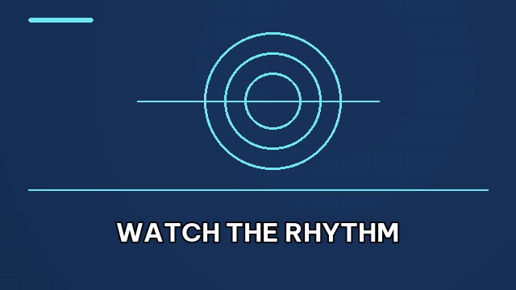
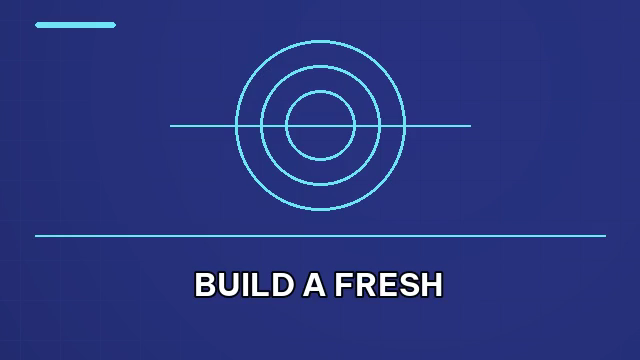

# REA-Video-Pro-Max

## 给 Claude 和 Codex 一双剪辑师的眼睛。

**拆解参考视频的节奏、字幕与运动。把剪辑选择沉淀为可复用风格，再用你自己的文案和素材，渲染一支新视频。**

好剪辑自有语言。现在，把这种语言变成你的创作工具。

[**▶ 体验在线演示**](https://hieunguyenak92.github.io/rea-video-pro-max/) · [**下载 Skill**](https://github.com/hieunguyenak92/rea-video-pro-max/releases/download/v0.1.1/rea-video-pro-max-v0.1.1-skill.zip) · [v0.1.1 版本](https://github.com/hieunguyenak92/rea-video-pro-max/releases/tag/v0.1.1)

[English](README.md) · [Tiếng Việt](README.vi.md) · [한국어](README.ko.md) · [日本語](README.ja.md) · [Español](README.es.md) · [Português](README.pt-BR.md) · [简体中文](README.zh-CN.md) · [ไทย](README.th.md) · [Français](README.fr.md)

**Claude Code / Codex Skill · CLI + 可选 MCP · 本地处理 · Apache-2.0**

---

## 从“这个剪辑真好”，到“这是我的作品”。

你遇见一支很有感觉的视频：切镜的节奏、字幕落下的时机、句子中流动的强调色，以及让静态画面有了动势的缩放。

REA-Video-Pro-Max 把其中受支持的风格要素，转化为可检查、可调整、可复用的内容。带上新脚本、图片、视频片段或旁白。最终留在你手里的，是可编辑项目和真正渲染完成的新视频。

| 参考视频 A | 你的新视频 B |
| :---: | :---: |
| [](https://hieunguyenak92.github.io/rea-video-pro-max/#workspace) | [](https://hieunguyenak92.github.io/rea-video-pro-max/#workspace) |
| 研究镜头节奏与字幕处理。 | 把可复用风格应用到另一个故事。 |

*画面来自随附的自制演示。B 使用新文案、独立生成的素材以及新的字幕时间。[交互演示](https://hieunguyenak92.github.io/rea-video-pro-max/#workspace)支持拖动查看两支视频，并检查记录的时间线、模板、项目与验证结果。*

```text
Reference video → editing evidence + timeline → reusable style
                                                   + your new content
                                                   → editable project + Video B
```

## 让参考视频进入真正的创作流程

| 你想做什么 | 你会得到什么 |
| --- | --- |
| 理解一支视频为何呈现这样的感觉 | 关联时间戳与证据的镜头区间、可见文字、字幕外观、表观运动和音频线索。 |
| 把字幕处理带进新故事 | 可复用的字体排版、布局和强调色板，应用于新文字及其新时间。 |
| 建立可反复使用的视频格式 | 能绑定另一份脚本与另一组素材的风格模板。 |
| 掌控最终结果 | 包含素材副本与哈希、可检查、修改并再次渲染的原生 JSON 时间线/项目。 |
| 接入自己的工作流 | 结构化文件、离线检查器、字幕导出，以及能力边界明确的时间线交换格式。 |

用于产品介绍、教学短片、创作者系列、剪辑研究，或自己的视频工具。只需要拆解时，分析文件与时间线本身就是完整交付物。

## 一条提示词，启动整个流程

安装随附 Skill，把参考视频和新内容交给智能体，然后这样请求：

```text
Use REA-Video-Pro-Max to break down reference.mp4: shot rhythm,
subtitle layout, highlight colors and supported motion.
Extract a reusable style, then use my new script and assets to make
an original video with a similar editing language.
Render the video, keep the editable project, verify the new content,
and show me any effects that need an approximation.
```

你决定故事。Skill 为智能体提供具体流程和可执行工具，完成分析、编排、渲染与验证。

## 真正进入制作环节的能力

- **有迹可循的剪辑分析。** 解码后的显示时间戳、帧证据与覆盖范围，让时间线可追溯。测量信号、模型结果、推断的剪辑选择分别标记。
- **能传递到下一支视频的字幕细节。** 估计可见字号、位置、填充与描边，保留不同的已观测强调色板和风格变体。编排时，为新文字重新换行和定时。
- **保留方向感的运动。** 在限定范围内拟合相似/仿射运动与时间曲线候选。原生渲染器可复用受支持的有向缩放分量，包括缩小。
- **可以持续迭代的项目。** 将新图片、视频片段、字体与可选音频复制进可移植项目。明确的内容绑定与哈希，让所选内容可检查。
- **需要时再启用语音。** 可选的本地 faster-whisper ASR 提供由模型推导的词级时间区间。通过严格的脚本/音频匹配，可将其绑定到新内容；必须明确提供本地模型。
- **能够核验的成片。** 核对项目/输出身份，解码渲染视频，并独立使用 OCR 检查字幕内容。证据与作品一起保留。

原生渲染器支持 **static / fade / pop / slide 字幕**、**cut / dissolve / fade / wipe 转场**，以及 **static / 有方向的 panzoom 背景**。分析可以保留比原生渲染器可复现范围更丰富的运动观测。[准确支持范围（英文）](docs/SUPPORT-MATRIX.md)。

## 跑出你的第一个结果

### 1. 准备运行环境

使用 **Python 3.11+**、**FFmpeg + FFprobe**，以及包含 **libx264** 的 FFmpeg 构建。运行随附 OCR 与字幕验证示例时，需安装带 **`eng` 语言数据的 Tesseract**。Python 依赖通过以下命令安装。

```sh
git clone https://github.com/hieunguyenak92/rea-video-pro-max.git
cd rea-video-pro-max
python3 -m venv .venv
. .venv/bin/activate
python -m pip install -e .
rea-video-pro-max doctor
```

这些 shell 命令面向 macOS/Linux。发布 CI 已在 Linux 与 macOS 通过；Windows 原生渲染尚未认证。`doctor` 会报告本机实际可用的工具。

### 2. 为智能体添加 Skill

将 **整个** `skills/rea-video-pro-max` 文件夹复制到项目的 Skill 目录：

| 宿主 | 项目内目标位置 |
| --- | --- |
| Claude Code | `.claude/skills/rea-video-pro-max` |
| Codex | `.agents/skills/rea-video-pro-max` |

也可将 [Skill ZIP](https://github.com/hieunguyenak92/rea-video-pro-max/releases/download/v0.1.1/rea-video-pro-max-v0.1.1-skill.zip) 解压到该位置。保持 `lib`、`assets`、`scripts` 与 `references` 在一起。仅使用 ZIP 安装时，通过 `python -m pip install -r /path/to/rea-video-pro-max/requirements.txt` 安装 Python 依赖，入口为 `python /path/to/rea-video-pro-max/scripts/rea-video-pro-max.py`。下方控制台命令由上面的仓库安装提供。智能体必须使用已装好这些依赖的解释器。

### 3. 运行随附 A → B 示例

```sh
rea-video-pro-max analyze examples/reference.mp4 --out work/analysis --ocr required --ocr-lang eng
rea-video-pro-max template work/analysis/analysis.json --out work/style-template.json
rea-video-pro-max compose work/style-template.json --content examples/content.json --out work/project
rea-video-pro-max render work/project/project.json --out work/video-b.mp4
rea-video-pro-max verify work/project/project.json --mode style-transfer --render work/video-b.mp4 --ocr-lang eng
```

打开 `work/video-b.mp4`。可移植项目位于 `work/project/`，参考视频分析位于 `work/analysis/`。每次编排使用新的输出目录。如需离线分析检查器，运行：

```sh
rea-video-pro-max report work/analysis/analysis.json --out work/report
```

然后在本地打开 `work/report/timeline.html`。[CLI、Skill 和可选 MCP 共用同一内核（英文）](skills/rea-video-pro-max/references/runtime-and-support.md)。

<details>
<summary><strong>换成你的内容：内容绑定文件里有什么？</strong></summary>

内容绑定是指定新场景、文字、素材及可选音频/字体的 JSON 文件。智能体可以根据普通创作需求生成。先从 [examples/content.json](examples/content.json) 开始。

```json
{
  "schema_version": 1,
  "kind": "rea-video-content",
  "width": 640,
  "height": 360,
  "fps": 24,
  "scenes": [
    {
      "id": "intro",
      "text": "Your next story starts here",
      "duration": 3.0,
      "background": [18, 24, 38],
      "accent": [108, 240, 190]
    }
  ]
}
```

通过 `asset` 路径添加图片或视频，通过 `audio` 明确指定配乐或旁白。素材路径相对于这份 JSON 文件解析。渲染器使用所选新内容；如需复用与参考视频完全相同的媒体，必须明确选择允许。

新文字拥有新的时间。按字符数加权的时间只是估计。语音时序很重要时，请提供新词级时间区间，或使用严格匹配的本地 ASR。[语音与运动指南（英文）](skills/rea-video-pro-max/references/speech-and-motion.md)。

</details>

## 看见承诺背后的实际工作

**v0.1.1 通过了 176 项本地测试**，包含真实运行的可选本地 ASR 案例。[托管 CI 的三项 Linux/macOS 作业均已通过](https://github.com/hieunguyenak92/rea-video-pro-max/actions/runs/43324016397)。发布的六个上传产物均已下载，并与本地字节和校验和核对。

证据包括完整的自制 **A → 分析 → 风格 → 新 B** 重放、包含修正字体排版/描边及两种强调方案的独立越南语任务，以及保留放大/缩小方向的运动任务。这些是范围限定的自制案例，证明演示流程可运行，并不代表广泛的题材或语言准确率。

[检查分析](docs/evidence/reference-analysis.json) · [查看模板](docs/evidence/style-template.json) · [打开项目](docs/evidence/project.json) · [检查验证结果](docs/evidence/verification.json) · [验证详情（英文）](docs/VALIDATION.md)

## 留住成果，继续扩展

| 格式 | 包含内容 |
| --- | --- |
| 原生 JSON | 分析、时间线、字幕/风格/运动/音频数据、模板，以及可编辑的原生项目。 |
| CSV | 用于检查和后续处理的镜头记录行。 |
| SRT / WebVTT | 可见文字与字幕时间区间。 |
| ASS | 使用明确替代风格的字幕时间；观测外观与不确定性保留在原生证据中。 |
| OTIO / EDL | 可选的 OTIO 参考片段与注释；用于已测量整数 CFR 剪切点的 EDL。导出回执说明信息损失。 |
| MP4 + 离线 HTML | 新视频，以及可在本地检查的分析报告。 |

原生项目是可编辑 JSON。此版本不导出 Premiere、Resolve、After Effects 或 CapCut 原生项目，也不导出 FCPXML。将受支持的交换文件导入外部编辑器仍未经验证。[导出器与渲染器边界（英文）](docs/SUPPORT-MATRIX.md)。

## 了解创作边界

当前版本专注于可观测的剪辑证据与受支持的 **2D** 风格复用。准确的原始字体、隐藏图层、插件、源素材及项目历史可能仍然未知。OCR 和运动拟合可能出错；采样覆盖范围与不确定性会保留可见。

绑定的视频需方向正确且使用方形像素。场景视频音轨会静音，请明确提供音频。复杂文字需要合适的字体与塑形支持；双向字幕会被拒绝。九种 README 翻译用于介绍产品，并不代表九种 OCR/渲染语言通过认证。创意风格与声音仍需人工审阅。[完整支持矩阵（英文）](docs/SUPPORT-MATRIX.md)。

核心处理在本地运行，无需付费模型 API 或上传内容。安装依赖和配置可选模型可能需要网络；Claude/Codex 宿主有各自的数据政策。本地报告默认包含参考媒体与裁剪图。`report --no-media` 仅省略完整参考副本，文字与裁剪图仍保留。[隐私说明（英文）](docs/PRIVACY.md)。

## 一起打造下一种剪辑工作流

**如果你也想把这种工作流加入创作工具箱，请为项目点一颗 Star。** 让更多创作者和 AI 开发者发现它。

**Fork，建立你自己的剪辑语言：** 添加字幕处理、开发渲染器适配器、扩展导出流程，或贡献自制参考到成片的案例。带上可复现证据，让下一项能力经得起检验。

[**⭐ 在 GitHub 点 Star**](https://github.com/hieunguyenak92/rea-video-pro-max) · [**🍴 Fork 并创作**](https://github.com/hieunguyenak92/rea-video-pro-max/fork) · [贡献指南（英文）](CONTRIBUTING.md) · [提交任务](https://github.com/hieunguyenak92/rea-video-pro-max/issues)

独立项目，灵感来自 [JuneYaooo/rea-video](https://github.com/JuneYaooo/rea-video)。采用 [Apache-2.0](LICENSE)；字体、编解码器和模型的独立条款保留于 [NOTICE](NOTICE)。

[支持（英文）](SUPPORT.md) · [维护（英文）](docs/MAINTENANCE.md) · [Skill 指令（英文）](skills/rea-video-pro-max/SKILL.md)
